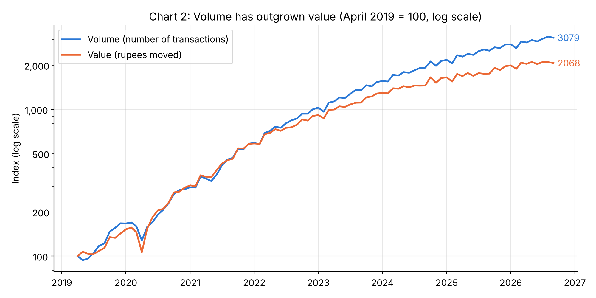
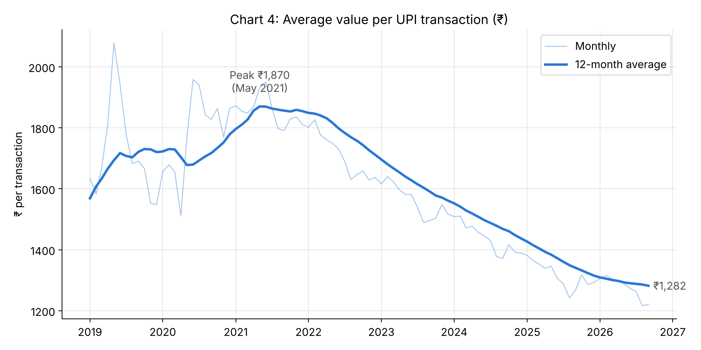
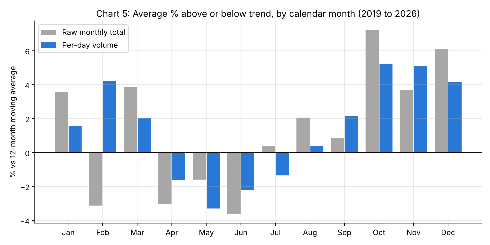
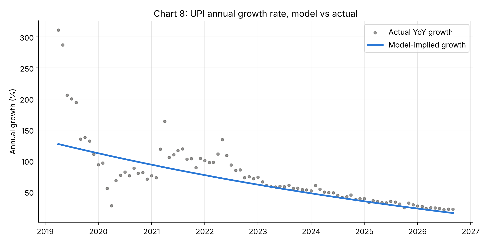

# UPI Is Growing in Count, Not in Money

An analysis of India's Unified Payments Interface (UPI) from April 2016 to September 2026 using official monthly statistics from the National Payments Corporation of India (NPCI). The project asks whether UPI's growth is slowing, and whether it is now driven by many small everyday payments rather than larger transfers.

**Author:** Devashish Kahate, MSc Economics (Data Analytics), Symbiosis School of Economics, Pune
**Course:** Python for Data Science, individual project

---

## Key results

| | Result |
|---|---|
| **Growth is slowing** | Year-on-year volume growth fell from **135%** (Sep 2019) to **23%** (Sep 2026). A regression with a quadratic trend confirms it: the t² coefficient is negative and significant (p < 0.001, Newey-West errors). Model-implied annual growth fell from **127%** (2019) to **16%** (2026). |
| **Payments are getting smaller** | Since April 2019, transactions grew **×30.8** but rupee value only **×20.7**. The 12-month average payment fell from **₹1,870** (May 2021) to **₹1,282** (Sep 2026), **31% smaller**. |
| **Raw monthly totals mislead** | February looks **3.1% below** trend on raw totals but is **4.2% above** trend per day. October to December are significantly above January (+4.4%, +3.8%, +2.7%): the festive season. |
| **COVID was a short shock** | The April to May 2020 lockdown cut volume **26.7%** below trend, followed by a fast recovery. |
| **"More banks, more UPI" is mostly a shared trend** | Banks live on UPI and volume correlate at **0.98** in levels but only **0.42** in year-on-year growth rates. |

### Volume has outgrown value


### The average payment is shrinking


### February was never weak: per-day adjustment


### The growth curve is bending: model vs actual


---

## Data

| | |
|---|---|
| Source | NPCI, [UPI Product Statistics](https://www.npci.org.in/product/upi/product-statistics) |
| Coverage | April 2016 to September 2026, monthly, national |
| Rows | 126 raw, 123 after cleaning |
| Columns | `fy` (financial year), `month`, `banks_live`, `volume_mn` (million transactions), `value_cr` (₹ crore) |

The raw file is kept exactly as published, including NPCI's formatting quirks, so that the cleaning step is reproducible:

- Indian comma format (`1,33,460.72`) mixed with plain numbers in the same column
- Stray spaces (`" 18,301.51 "`)
- A comma typo in NPCI's own figure for April 2026 (`29,029,88.05`), verified against neighbouring months
- Months stored as text, newest first
- April to June 2016 with zero transactions (dropped)

Every financial-year total in the CSV matches NPCI's published figures.

## Method

**Derived measures:** per-day volume (removes month-length effects), ticket size in ₹ (value ÷ volume), year-on-year growth (`pct_change(12)`), 12-month moving averages.

**Regression** (April 2019 to September 2026, n = 90):

```
log(daily volume) = β0 + β1·t + β2·t² + Σ γm·Month_m + δ·COVID + ε
```

- `t` = months since April 2019; **β2 < 0 means the growth rate itself is falling**
- Implied annual growth at month t = exp(12·(β1 + 2·β2·t)) − 1
- Month dummies (January baseline) capture seasonality; COVID = 1 for April and May 2020
- **Newey-West (HAC) standard errors, 12 lags:** Durbin-Watson is 0.70, so residuals are autocorrelated and ordinary standard errors would be too small (HAC standard errors are 1.8× larger)
- **Why start in 2019:** 2016 to 2018 was the launch phase, with growth of 300% to 1000%+. The t² result holds for every start date from 2017 to 2020

| Term | Effect | p-value |
|---|---:|---:|
| t² | −0.000315 | < 0.001 |
| COVID (Apr–May 2020) | −26.7% | < 0.001 |
| October vs January | +4.4% | 0.001 |
| November vs January | +3.8% | 0.026 |
| December vs January | +2.7% | 0.004 |
| R² | 0.997 | |

## Repository structure

```
├── 2026-10-26-upi-analysis.ipynb        # full analysis, with outputs
├── 2026-10-26-npci-upi-monthly-raw.csv  # NPCI data, as published
├── charts/                              # 9 charts exported by the notebook
├── presentation/
│   └── 2026-10-26-upi-presentation.html # interactive slide deck (open in a browser)
├── requirements.txt
└── LICENSE
```

## How to run

```bash
git clone https://github.com/DevashishK-cloud/upi-npci-analysis.git
cd upi-npci-analysis
pip install -r requirements.txt
jupyter notebook 2026-10-26-upi-analysis.ipynb
```

Run all cells. The notebook reads the CSV from the same folder and rewrites the charts in `charts/`. With Anaconda, all requirements are already installed.

The presentation is a single HTML file: download it and open it in Chrome or Edge. Use the arrow keys to move between slides, **F** for fullscreen and **N** for speaker notes.

## Limitations

- National totals only: no split by merchant vs person-to-person payments, state or app, so the "small everyday payments" explanation is consistent with the data but not directly tested
- Ticket size is a mean; NPCI does not publish the median
- The quadratic trend describes the slowdown within the sample and is not a forecast
- The COVID dummy covers only the 2020 lockdown; the 2021 second wave shows up in the residuals

## References

- National Payments Corporation of India. *UPI Product Statistics.* https://www.npci.org.in/product/upi/product-statistics (accessed October 2026)
- Newey, W. K., & West, K. D. (1987). A simple, positive semi-definite, heteroskedasticity and autocorrelation consistent covariance matrix. *Econometrica*, 55(3), 703–708.

## License

Code is released under the MIT License. The data is published by NPCI and remains subject to NPCI's terms.
